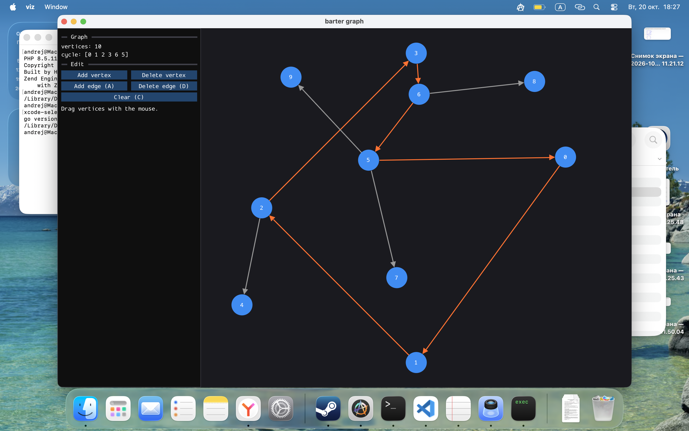
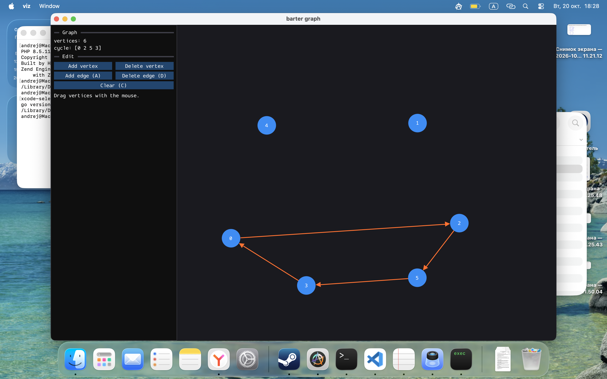

# gographsbarter

В планах

Движок матчинга для бартерной платформы коллекционных карточек: ищет циклы обмена в графе предпочтений пользователей.

Пока просто пупс с визуализацией графа и поиска цикла через дфс

## Структура

- `matching/` движок, чистый Go без зависимостей
- `viz/` визуализатор и редактор графа на cimgui-go (отдельный модуль, нужен cgo)

## Запуск

Нужно:

- Go 1.25+
- компилятор C и C++ (gcc или clang), визуализатор собирается через cgo
- заголовки OpenGL, на Linux также dev-пакеты X11

//TODO
Тесты движка

Визуализатор:

    cd viz
    go run .

## Управление в визуализаторе

- драг вершин мышью
- A: добавить ребро
- D: удалить ребро
- Add edge / Delete edge: клик по двум вершинам
- Esc: отменить текущее действие
- C: очистить граф

Ребра найденного цикла подсвечиваются оранжевым (пока показывает только 1 цикл)
//TODO больше циклов больше цветов